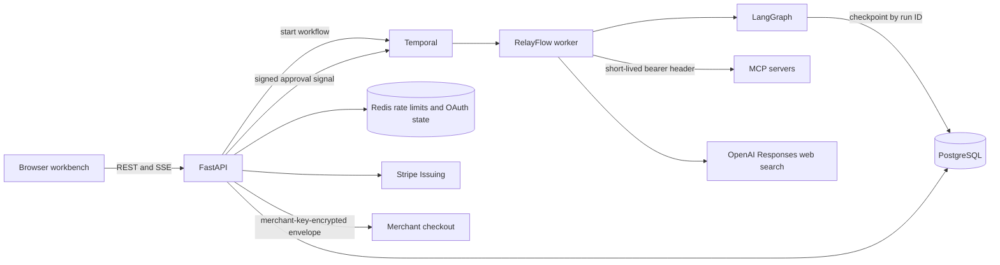

# NexusRelay

NexusRelay is an open-source starter for two connected systems:

1. **RelayFlow** runs long tasks through research, drafting, and separately approved external actions.
2. **OACP 0.1** defines merchant discovery and cart intent, then exchanges a signed purchase approval for a one-time, spend-capped Stripe Issuing card.

This repository implements the starter monorepo, durable worker, browser workbench, token vault, OAuth authorization-code flow, OACP schemas, Stripe Issuing service, and CI. It does not claim PCI, card-network, financial-services, or identity-provider certification.

## Repository layout

```text
apps/
  agent-worker/              FastAPI API, Temporal worker, LangGraph engine
    app/
      commerce/              OACP approval, Issuing, token exchange
      connectors/            MCP adapters for GitHub, Slack, Drive, Graph
      activities.py          Durable Temporal activities
      auth.py                OIDC validation; dev identity only for local use
      db.py                  PostgreSQL models and event store
      graph.py               Research → spec → approved PR → approved Slack graph
      main.py                REST, approvals, SSE, OAuth, OACP routes
      oauth.py               OAuth authorization code + state + PKCE callbacks
      token_vault.py         AES-GCM encrypted per-user OAuth token storage
      worker.py              Temporal activity/workflow worker
      workflows.py           Durable run and approval-signal workflow
  web/                       Next.js App Router + Tailwind workbench and OACP approval UI
packages/
  mcp-connectors/            Reusable Streamable HTTP MCP client
  oacp-spec/                 OACP 0.1 protocol, schemas, and exchange profile
infra/
  postgres/                   Local PostgreSQL initialization
docker-compose.yml            PostgreSQL, Redis, Temporal, API, worker, Next.js
.github/workflows/ci.yml      Lint, type-check, and container builds
```

## Architecture



Temporal is the durable job coordinator. LangGraph persists graph state in PostgreSQL under the Temporal run ID. A worker restart can replay workflow history and resume the same graph checkpoint. Approval waits are Temporal waits, so they do not occupy a worker process. Both `publish_pr` and `post_slack` are compile-time LangGraph `interrupt_before` breakpoints. The approval API verifies an Ed25519 signature over the exact action payload before it signals Temporal.

The SSE feed contains activity summaries and run state only. It deliberately does not expose private model reasoning. Browser approval private keys are non-exportable WebCrypto keys kept in IndexedDB; the API stores the public key and verifies each action signature.

## Local setup

Requirements: Docker Compose v2, Node.js 22+, Python 3.12+ for non-container development. For a clean checkout, copy `.env.example` to an ignored `.env.local` file and configure it. Do not overwrite an existing `.env.local` when it contains a key.

Generate distinct local secrets and put them in `.env.local`:

```bash
python -c "import base64,secrets;print('TOKEN_VAULT_KEY_B64='+base64.b64encode(secrets.token_bytes(32)).decode())"
python -c "import secrets;print('OACP_TOKEN_SIGNING_KEY='+secrets.token_urlsafe(48))"
python -c "import secrets;print('OACP_ADMIN_TOKEN='+secrets.token_urlsafe(48))"
python -c "import secrets;print('FRONTEND_WEBHOOK_SECRET='+secrets.token_urlsafe(48))"
```

Set `OPENAI_API_KEY`, `GITHUB_REPOSITORY`, `SLACK_CHANNEL_ID`, the MCP server URLs, and OAuth app credentials. Register these exact callback URLs in the provider apps:

- `http://localhost:8000/v1/integrations/github/oauth/callback`
- `http://localhost:8000/v1/integrations/slack/oauth/callback`
- `http://localhost:8000/v1/integrations/google_drive/oauth/callback`
- `http://localhost:8000/v1/integrations/microsoft_graph/oauth/callback`

Then start the stack:

```bash
docker compose up --build
```

Compose waits for the `migrate` service to apply the Alembic schema before starting API and worker processes.

Open [http://localhost:3000](http://localhost:3000), connect integrations, and start a run. The API documentation is at [http://localhost:8000/docs](http://localhost:8000/docs); Temporal's local UI is at [http://localhost:8233](http://localhost:8233). A run needs an approval key, a valid repository and Slack destination, and configured MCP servers. The first PR and Slack actions each pause for a separate approval.

For non-container development, install the local packages and run API, worker, and web as separate processes:

```bash
python -m pip install -e packages/mcp-connectors -e apps/agent-worker
uvicorn app.main:app --reload --app-dir apps/agent-worker
python -m app.worker
npm install
npm --workspace apps/web run dev
```

## Configuration notes

| Variable group | Purpose |
| --- | --- |
| `OPENAI_API_KEY`, `OPENAI_MODEL` | Research and specification generation through Responses API web search. |
| `TEMPORAL_*`, `DATABASE_URL`, `REDIS_URL` | Durable workflows, graph checkpoints, event storage, rate limits, and one-use OAuth state. |
| `MCP_*_URL` | Streamable HTTP MCP servers for GitHub, Slack, Google Drive, and Microsoft Graph. |
| `OAUTH_*_CLIENT_*`, `OAUTH_*_REDIRECT_URI` | Provider authorization code flow. OAuth tokens are encrypted with `TOKEN_VAULT_KEY_B64`; access tokens are never put in graph state. |
| `AUTH_MODE`, `OIDC_ISSUER`, `OIDC_AUDIENCE` | Use `dev` only for the local header-based identity. Production startup requires OIDC. |
| `STRIPE_SECRET_KEY`, `STRIPE_ISSUING_CARDHOLDER_ID` | Stripe Issuing account and eligible cardholder used after signed purchase approval. |
| `OACP_TOKEN_SIGNING_KEY`, `OACP_ADMIN_TOKEN` | Separate OACP capability-token and merchant-registry secrets. |

The demo OIDC development identity is not production authentication. For production, configure an OIDC client in the web app or trusted ingress, require HTTPS, keep secrets in a managed secret store, and use a KMS/HSM-backed data-encryption key for the token vault. The current AES-GCM vault accepts a 32-byte key from the runtime environment; do not use a checked-in or shared key.

## Phase 2: RelayFlow execution

The workflow stages are:

1. `research_topic` uses current web search and records a sourced brief.
2. `draft_spec` creates a Markdown specification.
3. `interrupt_before=["publish_pr"]` records a review payload. A signed approval permits branch creation, spec commit, and draft PR creation through GitHub MCP.
4. `interrupt_before=["post_slack"]` asks separately before sending the summary through Slack MCP.

Temporal activities have bounded retries and long start/schedule timeouts; the graph uses a PostgreSQL checkpointer. External action nodes use deterministic branch and file names plus a PR search before creating a new PR. MCP access tokens are resolved from the per-user encrypted token vault and only appear in the transport authorization header. Drive and Graph connector methods also require an approved action record before document publication or email.

## Phase 3: OACP and Stripe Issuing

The normative schemas are in `packages/oacp-spec/schemas/`. Merchant manifests are HTTPS-only, Ed25519-signed, and must match an administrator-registered origin and signing key. Cart lines must sum to the exact amount in minor units, and the user signature binds the cart and manifest digests, merchant, category, currency, order, and expiry.

After a valid `approve_purchase` signature, the service creates a Stripe Issuing virtual card with:

- an `all_time` spending limit equal to the approved total,
- one allowed Stripe Issuing merchant category,
- automatic cancellation after one non-zero payment authorization,
- an idempotency key tied to the purchase intent.

The browser receives only an opaque short-lived checkout token. The merchant must authenticate to `/v1/commerce/checkout-token/exchange` with its registered credential and an ephemeral X25519 public key. The server retrieves PAN/CVC from Stripe only during exchange, encrypts them immediately with X25519 + HKDF-SHA256 + AES-256-GCM to that merchant key, stores only the ciphertext envelope for idempotent retry, and never returns plaintext card data to the browser or agent. The merchant token is single-use and merchant-bound; unused cards are cancelled by the worker's expiry sweep.

Before accepting carts, register the merchant's HTTPS origin, manifest signing key, and exchange credential at `PUT /v1/commerce/merchants/{merchant_id}/trust` using `X-OACP-Admin-Token`. Keep the merchant private signing and X25519 keys on the merchant side. The test UI requires a real signed merchant manifest; it does not make the demo merchant trusted automatically.

**PCI scope:** retrieving PAN/CVC through Stripe's API can put the payment service in PCI scope, especially when issuing cards to users. Stripe recommends Issuing Elements for cardholder display and notes the PCI requirements for service providers. This exchange implementation therefore requires a formal security and PCI review before live use. Stripe Issuing account eligibility and regional availability also apply. See [Stripe card details guidance](https://docs.stripe.com/issuing/cards/virtual) and [Stripe Issuing card controls](https://docs.stripe.com/api/issuing/cards/create).

## Phase 4: CI/CD

`.github/workflows/ci.yml` runs Python Ruff and mypy, Next.js ESLint and TypeScript checks, and builds both containers. It intentionally does not deploy. Pin dependency lockfiles and add organization-specific review, migration, and deployment steps before production releases.

